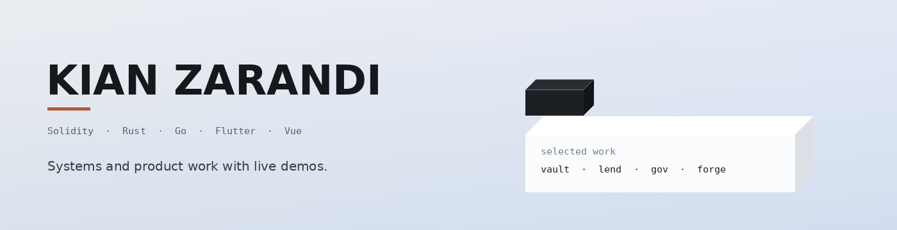
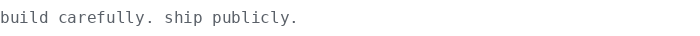
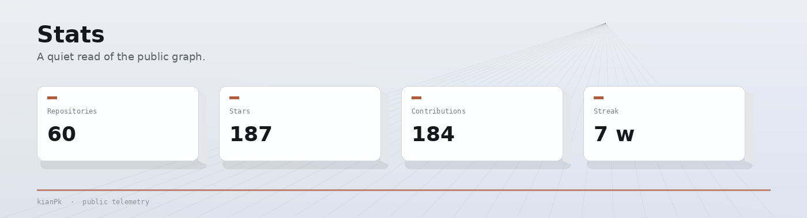
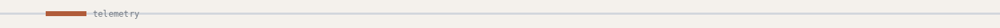

<div align="center">





<br/><br/>

[Portfolio](https://kianpk.github.io/kianPk/)
&nbsp;·&nbsp;
[VaultForge](https://kianpk.github.io/vaultforge/)
&nbsp;·&nbsp;
[LendGrid](https://kianpk.github.io/lendgrid/)
&nbsp;·&nbsp;
[GovStack](https://kianpk.github.io/govstack/)
&nbsp;·&nbsp;
[Loadforge](https://kianpk.github.io/loadforge/)
&nbsp;·&nbsp;
[Email](mailto:kianzarandi701@gmail.com)

<br/><br/>

Systems and product work — Solidity protocol labs, Rust services, Go gateways, Flutter and Vue clients.

Iran · freelance & product · [zyrax.ir](https://www.zyrax.ir)

</div>

---

## Work

| | | |
|:--|:--|:--|
| **Solidity** | [vaultforge](https://github.com/kianPk/vaultforge) · [lendgrid](https://github.com/kianPk/lendgrid) · [govstack](https://github.com/kianPk/govstack) | Vault, lending, DAO |
| **Rust** | [loadforge](https://github.com/kianPk/loadforge) | Concurrent HTTP load forge |
| **Go** | [gateproxy](https://github.com/kianPk/gateproxy) · [pulsehub](https://github.com/kianPk/pulsehub) | Gateway · realtime hub |
| **Flutter** | [notecraft](https://github.com/kianPk/notecraft) · [pulseboard](https://github.com/kianPk/pulseboard) | Notes · ops dashboard |
| **Vue / Node** | [forge-desk](https://github.com/kianPk/forge-desk) · [lumen-commerce](https://github.com/kianPk/lumen-commerce) | Product surfaces |
| **Security** | [honeypot-deck](https://github.com/kianPk/honeypot-deck) · [sentinel-grid](https://github.com/kianPk/sentinel-grid) · [vaultguard](https://github.com/kianPk/vaultguard) | Defensive labs |

---

## Solidity

<div align="center">
  <a href="https://github.com/kianPk/vaultforge"></a>
  <a href="https://github.com/kianPk/lendgrid"></a>
  <a href="https://github.com/kianPk/govstack"></a>
</div>

| Project | Focus | Demo |
|:--------|:------|:-----|
| [vaultforge](https://github.com/kianPk/vaultforge) | ERC-4626 · strategies · fees · caps · Foundry | [open](https://kianpk.github.io/vaultforge/) |
| [lendgrid](https://github.com/kianPk/lendgrid) | Collateral · interest · HF · liquidations | [open](https://kianpk.github.io/lendgrid/) |
| [govstack](https://github.com/kianPk/govstack) | Votes · Governor · Timelock · Treasury | [open](https://kianpk.github.io/govstack/) |

```bash
git clone https://github.com/kianPk/vaultforge && cd vaultforge && make install && make test
```

---

## Rust · Go · Flutter

<div align="center">
  <a href="https://github.com/kianPk/loadforge"></a>
  <a href="https://github.com/kianPk/gateproxy"></a>
</div>

| Project | Stack | Demo |
|:--------|:------|:-----|
| [loadforge](https://github.com/kianPk/loadforge) | Rust · Tokio · Axum · WebSocket | [open](https://kianpk.github.io/loadforge/) |
| [gateproxy](https://github.com/kianPk/gateproxy) | Go · JWT · rate limit · proxy | [open](https://kianpk.github.io/gateproxy/) |
| [pulsehub](https://github.com/kianPk/pulsehub) | Go · WebSocket rooms | [open](https://kianpk.github.io/pulsehub/) |
| [notecraft](https://github.com/kianPk/notecraft) | Flutter · local-first | [open](https://kianpk.github.io/notecraft/) |
| [pulseboard](https://github.com/kianPk/pulseboard) | Flutter · ops UI | [open](https://kianpk.github.io/pulseboard/) |

---

## CLIs

| | | |
|:--|:--|:--|
| [portkill](https://github.com/kianPk/portkill) | Go | Free a busy TCP port |
| [gitsum](https://github.com/kianPk/gitsum) | Rust | Repo summary |
| [envdoctor](https://github.com/kianPk/envdoctor) | Python | `.env` vs example |
| [tlsage](https://github.com/kianPk/tlsage) | Python | Cert days left |
| [deadlinks](https://github.com/kianPk/deadlinks) | Node | Broken links |

---

## Stats

<div align="center">





<br/>


<br/>


<br/><br/>


<br/><br/>

<a href="https://github.com/kianPk/vaultforge"></a>
<a href="https://github.com/kianPk/loadforge"></a>

</div>

---

<div align="center">

[Portfolio](https://kianpk.github.io/kianPk/) · [GitHub](https://github.com/kianPk) · [Email](mailto:kianzarandi701@gmail.com) · [zyrax.ir](https://www.zyrax.ir)

</div>
