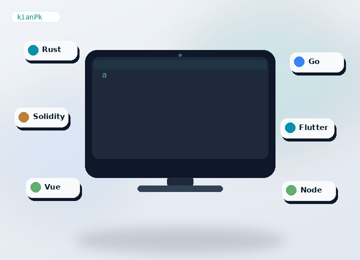

## Hey 👋, I'm Kian Zarandi!

I wear different hats depending on the project — **Solidity protocol labs** ⛓️, **Rust services** 🦀, **Go gateways** 🚪, **Flutter apps** 📱, and **Vue / Node** product surfaces 🌐. I like shipping live demos and keeping the stack practical.
 
 

### 🧐 More About Me:

- 🔭 &nbsp; I’m currently building **VaultForge**, **LendGrid**, and **GovStack**
- 🤝 &nbsp; Open to collaborate on [loadforge](https://github.com/kianPk/loadforge) and [gateproxy](https://github.com/kianPk/gateproxy)
- 🌱 &nbsp; Deepening Solidity protocol work and Rust systems
- 👨🏻‍💻 &nbsp; Most of my projects are on [GitHub](https://github.com/kianPk?tab=repositories)
- 🎨 &nbsp; Live demos: [Portfolio](https://kianpk.github.io/kianPk/) · [VaultForge](https://kianpk.github.io/vaultforge/) · [Loadforge](https://kianpk.github.io/loadforge/)
- 💬 &nbsp; Ask me about Solidity, Rust, Go, Flutter, or Vue
- 📫 &nbsp; Reach me at [kianzarandi701@gmail.com](mailto:kianzarandi701@gmail.com)
- 📝 &nbsp; Product & freelance · Iran · [zyrax.ir](https://www.zyrax.ir)
- ⚡ &nbsp; Defensive security labs too — honeypot-deck, sentinel-grid, vaultguard

 

### 🔨 Languages and Tools:

  
  
  
  
  
  
  
  
  
  
  
  

 

### 📊 Github Stats

 

 

### 🛠️ My Projects

